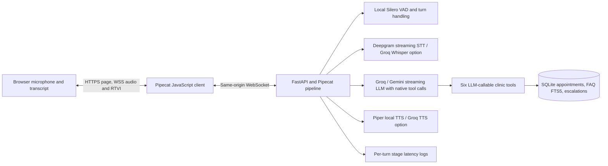

# Careline Clinic Voice Receptionist

Careline is an MIT-licensed, English-first prototype of a browser voice receptionist for a small clinic. It uses Pipecat for real-time orchestration and LLM function calling for action selection. It can check slots, book, reschedule and cancel demo appointments, answer from a small FAQ, and record a pending staff follow-up. It does **not** provide medical advice, phone service, or production-grade patient-data handling.

The sample clinic, hours, fees, appointments and names are fictional. Do not put real patient or health information into this demo.

## Architecture



The model selects and calls tools through Pipecat's function-calling context. There is no intent-classifier or keyword/regex action router. Python validates the arguments and the database enforces scheduling rules; those deterministic checks return structured errors for the model to recover from. Pipecat's context aggregators preserve the current conversation across turns in that voice session. The session transcript and audio are not stored by the application.

The browser uses Pipecat's WebSocket transport rather than WebRTC so it can use the same HTTPS/WSS listener on a basic free host. WebSocket audio is simpler to deploy, but it uses TCP and can be less resilient to network delay than WebRTC. The UI requires browser microphone permission and a secure origin (localhost is suitable for local development).

## Requirements and local setup

The project targets Python 3.12 and Node 22.12 or later. The tested workspace was Python 3.12.3 and Node 22.13. It does not require Docker, a GPU, a local LLM, a vector database, or MLOps. Silero VAD and Piper run locally on CPU; the LLM and default streaming STT are remote APIs. A specific 4 GB Acer laptop was not available for a memory/performance measurement.

```bash
# Linux/macOS
python3.12 -m venv .venv
source .venv/bin/activate
python -m pip install -r requirements.txt
cp .env.example .env
# Edit .env with the two default provider keys described below.
npm --prefix web ci
npm --prefix web run build
uvicorn backend.careline.app:app --host 127.0.0.1 --port 3000
```

Open `http://127.0.0.1:3000`. For frontend hot reload, keep the Python server on port 3000 and run `npm --prefix web run dev` in a second terminal; Vite listens on port 3001 and proxies `/ws` to FastAPI. On Windows, create the virtual environment with `py -3.12 -m venv .venv`, activate it with `.venv\\Scripts\\activate`, and use the same pip/npm commands.

The application serves the built UI, favicon and `/manus-routes.json`; `/healthz` is an unauthenticated health check. The Vite production build is created under `web/dist/`, which is ignored by Git and regenerated during deployment.

## API keys: exactly what to create

For the **default configuration**, create exactly these two keys:

1. **`GROQ_API_KEY`** — create a Groq Cloud account and an API key at [Groq Console API Keys](https://console.groq.com/keys). This powers the default `openai/gpt-oss-20b` LLM. Groq documents free-plan rate limits, including limits for this model; check your account's current limits and do not enable paid billing if you want to remain at zero cost. [Groq model and rate-limit documentation](https://console.groq.com/docs/rate-limits)
2. **`DEEPGRAM_API_KEY`** — create a key in the [Deepgram Console](https://console.deepgram.com/). The current public pricing page offers a finite $200 free credit and says no credit card is required. It is a credit, not a permanent unlimited free tier; stop using it before the credit runs out if you do not want any paid usage. [Deepgram pricing](https://deepgram.com/pricing)

The default `TTS_PROVIDER=piper` is open-source local TTS and needs **no** API key. The optional `GEMINI_API_KEY` is created in [Google AI Studio API Keys](https://aistudio.google.com/app/apikey); set it only when changing `LLM_PROVIDER=gemini`. Gemini 3.8 Flash currently lists a free tier, but Google's free-tier terms state that submitted content may be used to improve products. Do not send real patient or health data. [Gemini models](https://ai.google.dev/gemini-api/docs/models) · [Gemini pricing and data-use notes](https://ai.google.dev/gemini-api/docs/pricing)

Switch provider names in `.env`; do not put keys in source files or the browser. `GROQ_API_KEY` is reused if Groq Whisper or Groq TTS is selected. Groq's optional Orpheus TTS endpoint has a published per-character price and free-plan rate limits; for a strict no-charge setup, leave `TTS_PROVIDER=piper`. [Groq TTS models and pricing](https://console.groq.com/docs/text-to-speech) · [Groq rate limits](https://console.groq.com/docs/rate-limits)

| Component | Default | Configurable alternatives | Key needed |
|---|---|---|---|
| LLM | Groq `openai/gpt-oss-20b` | Gemini `gemini-3.8-flash` | Groq key by default; Gemini key if switched |
| STT | Deepgram streaming `nova-3-general` | Groq Whisper `whisper-large-v3-turbo` | Deepgram key by default; existing Groq key if switched |
| TTS | Piper `en_US-lessac-medium` on CPU | Groq Orpheus English | None for Piper; existing Groq key for Groq TTS |

All provider values, model names, clinic name/hours, timezone, lunch break, workdays, appointment length and database path are set in `.env.example` and `backend/careline/config.py`. The browser and generated hours/slot-length FAQ use those settings, and seeded FAQ entries are refreshed from `clinic_faq.json` at startup. Groq Whisper is a turn/utterance transcription path rather than Deepgram's continuously streamed interim transcript. Provider free limits, model availability, and terms can change; this project does not add payment methods or configure paid billing.

## Clinic tools, retrieval, and safety

The LLM can call exactly these business tools: `check_available_slots`, `book_appointment`, `reschedule_appointment`, `cancel_appointment`, `lookup_clinic_info`, and `escalate_to_human`.

Pydantic schemas reject extra fields and validate ISO dates, 24-hour times, caller-confirmation flags, reference codes, names, and escalation categories. SQLite transactions and a partial unique index prevent two active bookings from taking the same slot. A failed or taken slot returns a recoverable result. The prompt directs the model to read back the exact name, date and time and wait for clear caller agreement; the booking tool rejects `caller_confirmed=false`. This is model/prompt-dependent: the server does not independently verify that the caller agreed. Moving or cancelling a booking requires both the reference code and caller-provided name. The database stores a hash of each reference, and there is no general patient-search tool.

The clinic FAQ is seeded into SQLite and retrieved with FTS5. The lookup function returns only matched question/answer passages. The system prompt tells the model to use this tool for clinic facts and to say “I don't know from the clinic information I have” when retrieval finds nothing. This is prompt-guided grounding, not a formal guarantee against model error; the live model path has not been evaluated in this workspace.

The receptionist prompt prohibits medical advice and directs emergencies to local emergency services or emergency care immediately, with an escalation record. `escalate_to_human` creates a pending follow-up row only; it does not contact a person, transfer a call, or dispatch emergency services. There is no identity verification beyond a caller-provided name plus booking reference. The app is therefore a demonstration, not a compliant clinical system.

## Observability and latency

The Pipecat frame observer logs one `turn_latency` record and a `latency_summary` when a session ends. Fields include STT elapsed from first detected speech to final transcript, cumulative LLM response time across tool-call rounds, TTS start-to-stop time, time to first audio after the final transcript, and total first-speech-to-first-audio time. Logs intentionally omit audio, transcript text, names, reference codes and tool arguments. The STT elapsed value includes the caller's spoken duration; it is not just the provider's network processing time.

| Metric | Measured result in this run |
|---|---|
| STT per-turn latency | Not measured; no real Deepgram/Groq API key was supplied |
| LLM per-turn latency, including tool rounds | Not measured; no provider request was made |
| TTS per-turn latency in the full voice pipeline | Not measured; no live voice session was run |
| Total first-speech-to-first-audio | Not measured; microphone/provider end-to-end test not run |
| Local Piper model initialization | Model loaded on CPU; direct synthesis could not be verified outside a running Pipecat worker |

Do not treat unmeasured cells as zero. To collect real values, set valid provider keys, run the app, complete a voice session, and read the server's `turn_latency` and `latency_summary` logs.

## Evaluation and tests

The text-driven evaluation fixture contains **38 scripted conversations** across availability, booking and recovery, rescheduling, cancellation, slot conflict, malformed dates/arguments, FAQ and unknown questions, privacy, interruption, emergencies and escalation. `eval/run_eval.py` replays each fixture's declared tool trace against a fresh temporary SQLite database and saves the row-level table to `eval/results.csv`.

| Offline evaluation score | Result |
|---|---:|
| Tool/database task outcomes | 38/38 (100%) |
| Expected fixture tool trace matches the replayed trace | 38/38 (100%) |
| Live LLM choice of the correct tool | Not measured; fixture traces are hand-authored and no LLM call was made |

The 100% trace score validates the offline fixture and tool/database path. It does **not** mean the LLM passed 38 live conversation tests. The included `pytest` tests verify the database, tools, argument validation, retrieval, conflict handling, privacy-safe lookup behavior, Pipecat tool registration and latency recorder. Never use a production/shared patient database for these tests; they use temporary SQLite files.

Verified in the workspace:

| Check | Result |
|---|---|
| Python compile and pytest | 19 passed; one upstream Python `audioop` deprecation warning from Pipecat |
| Offline scenario evaluation | 38/38 task outcomes and 38/38 fixture-trace comparisons |
| TypeScript and production Vite build | Passed; 60 modules transformed |
| FastAPI smoke test | `/healthz`, `/`, `/manus-routes.json`, `/favicon.svg`, and `/api/config` returned HTTP 200; the SVG MIME type and route JSON were checked; path traversal returned 404 |
| Config/provider initialization | Groq/Gemini, Deepgram/Groq Whisper, Piper and Groq TTS service objects constructed with dummy keys; Piper and Silero VAD models loaded locally; no provider request or full audio output was tested |
| Render Blueprint parse | Valid YAML; Python runtime, free plan and `/healthz` health path checked |
| Live microphone, external LLM/STT call, barge-in, and end-to-end audio | Not tested; no service keys/browser audio were available |

Commands:

```bash
python -m compileall -q backend eval tests
python -m pytest -q
python eval/run_eval.py
npm --prefix web run build
```

## Design decisions

- **Pipecat plus function calling:** Pipecat owns transport, VAD, context, streaming frames and interruptions. The LLM chooses a business tool from typed function schemas; deterministic Python checks only validate arguments and perform safe database operations.
- **WebSocket for the first free-host build:** one HTTPS/WSS port avoids a separately exposed UDP media port. TCP head-of-line blocking is a known trade-off versus WebRTC, not hidden as equivalent media behavior.
- **SQLite with FTS5:** one local database keeps the demo small, transactional and easy to inspect. FTS5 avoids an embedding service, vector database, and model download. The same simplicity makes a free host's ephemeral disk unsuitable for real appointments.
- **Deepgram streaming STT:** chosen as the default because the Pipecat integration supports interim recognition and VAD-related turn behavior. Groq Whisper remains a config switch. Deepgram's current free credit is finite.
- **Piper as default TTS:** it is open-source, local, CPU-based, and avoids another API key. Groq TTS is optional, but its usage is metered and should not be selected for strict zero-cost operation.
- **Groq default LLM with Gemini switch:** both fit the requested tool-calling provider choices. Provider/model selection is environment-configured; quotas and terms are external and change over time.
- **Minimal session state:** Pipecat context is kept for the active conversation only; audio and transcript are not written to SQLite. Appointment and escalation records are stored because the tools need them.
- **Fictional clinic data and no patient lookup:** the sample FAQ is replaceable, while new booking data is caller-provided. Reschedule/cancel requires a booking reference and matching caller-provided name; no tool enumerates patient records.
- **Local VAD and short responses:** Silero VAD and concise prompt guidance support natural pauses and barge-in without loading a GPU model. Real interruption quality still needs a microphone test.
- **English first, future language switching:** locale/model settings are configurable, but the sample FAQ, prompt, Piper voice and tested UI are English only. Hindi/Punjabi require suitable provider models, prompts and voices.
- **No Docker or MLOps:** normal Python and npm commands build the app locally. The Render recipe downloads a pinned Node binary only during its build to compile the web client inside a native Python service.
- **Safety limitations:** emergency escalation is a logged follow-up, not a connection. No authentication, backups, EHR integration, medical review, or compliance certification is included.

## Deploy to Render Free without Docker

The repository includes `render.yaml`. Connect the repository in Render and create the Blueprint service. The service uses Render's native Python runtime, downloads Node 22.13.1 temporarily to build the UI, and runs Uvicorn on Render's `$PORT`; it does not build a Docker image. Add the `GROQ_API_KEY` and `DEEPGRAM_API_KEY` secrets in Render's environment-variable screen. If using Gemini instead, add `GEMINI_API_KEY` and set `LLM_PROVIDER=gemini`; otherwise no Gemini key is needed. Do not commit `.env` or enter payment credentials if you want to remain on free allocations. **The public `/ws` endpoint has no authentication or rate limiting:** anyone who reaches the service can start a voice session, attempt appointment-tool calls, and consume configured provider quotas. Keep a deployment private or add access controls and usage limits before exposing it with provider keys; the included recipe is a demo guide, not a hardened public service.

After deploy, check `/healthz`, then open the service URL and allow microphone access. Browser microphone access requires HTTPS on the hosted site. Render Free services can spin down when idle, so the first response after inactivity may be delayed. The recipe uses `/tmp/careline.sqlite3`; Render's free filesystem is ephemeral and appointments can disappear after restart/redeploy. Do not use the hosted instance for real clinic bookings or real patient data. See [Render Free](https://render.com/docs/free) and [Render web services](https://render.com/docs/web-services) for current availability and limitations.

## Limitations before any real clinic use

Careline is an educational/demo prototype. It has no login, authorization, caller identity proofing, audit program, database backups, retention controls, EHR integration, real staff notification, or medical-device/clinical safety certification. The sample clinic data is fictitious. Its SQLite store is designed for one small process and the documented Render Free host loses data. The LLM may misunderstand speech, fail to call a tool, or produce an ungrounded answer despite the system prompt. Providers receive request content under their own account terms; free Gemini content may be used for product improvement. Use only synthetic data until an organization has selected compliant providers, storage, security and legal review. Do not rely on it for emergencies: callers should contact local emergency services directly.

The VAD, tools, and local Piper model work on ordinary CPU without a graphics card, but end-to-end RAM consumption and latency have not been measured on a 4 GB laptop. Hindi/Punjabi are an extension point only, not a shipped capability.

## License

MIT; see [LICENSE](LICENSE). Pipecat and provider/model terms remain subject to their respective upstream licenses and service terms.
"# CareLine" 
